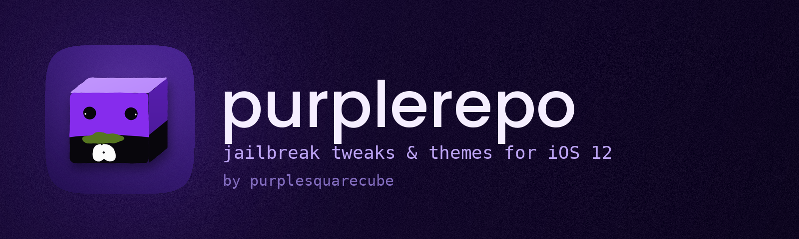

# purplerepo

A small Cydia/Sileo repo of jailbreak **tweaks** and **icon themes** for **iOS 12** (rootful, arm64).
Everything here is written by [purplesquarecube](https://github.com/purplesquarecube).

**Repo address**

```
https://purplesquarecube.github.io/purplerepo/
```

Open the [website](https://purplesquarecube.github.io/purplerepo/) on your iPhone for one-tap buttons, or add the address by hand:

| Package manager | How |
| --- | --- |
| Sileo | Sources > + (top right) > paste the address |
| Zebra | Sources > + > paste the address |
| Cydia | Sources > Edit > Add > paste the address |

Pull down to refresh the source, then install.

## Tweaks

| Name | Version | What it does | Where |
| --- | --- | --- | --- |
| **Tidy** | 1.0.0 | Clean up the Home Screen. Hide icon labels, notification badges and page dots, or make the dock background clear. Changes apply instantly. | Settings > Tidy |
| **TapLock** | 1.0.0 | Double-tap to lock. Double-tap an empty spot on the Home Screen or Dock to lock your device, so you never have to reach for the power button. | Settings > TapLock |
| **QuietHUD** | 1.0.0 | No more pop-ups. Hide the volume, brightness, ringer and rotation-lock pop-ups. The change still happens, you just don't see the overlay. | Settings > QuietHUD |
| **TapFeel** | 1.0.0 | Icons that answer back. Play a sound and bounce the icon when you tap an app. Pick from six system sounds and set how bouncy it is. | Settings > TapFeel |
| **BatteryLine** | 1.0.0 | A battery meter you can see in any app. A thin line along the top or bottom of the screen that shows your battery level on top of every app. Turns green while charging, orange under 50% and red under 20%. | Settings > BatteryLine |
| **Dimmer** | 1.0.0 | Darker than dark. Dims the screen below the normal minimum and adds an optional warm tint, on top of everything. Handy at night. It can run on a schedule. | Settings > Dimmer |
| **Umbra** | 1.0.0 | A dark mode for iOS 12. Makes app backgrounds dark using iOS's Smart Invert, one app at a time. Pictures and videos are left alone in most apps. It can run on a schedule, and the Home Screen can stay light. | Settings > Umbra |
| **PlugIn** | 1.0.0 | A little show when you plug in. A light sweep around the edge of the screen and a sound when you connect a charger: green when you plug in, orange when you unplug. | Settings > PlugIn |
| **SleepTimer** | 1.0.0 | Falls asleep before you do. Pick a time from 5 minutes to 2 hours and your music or video pauses when it ends. It can lock the device too. | Settings > SleepTimer |
| **BadgeColor** | 1.0.0 | Badges in your colour. Recolor the red notification badges on your icons and make them bigger or smaller. | Settings > BadgeColor |
| **FineVolume** | 1.0.0 | Volume, in smaller steps. Each press of a volume button changes the volume by less, so you can land on exactly the level you want. Set the step anywhere from a tenth to the normal size. | Settings > FineVolume |
| **WakeUp** | 1.0.0 | Wakes the screen when you plug in. Lights up the screen when you connect or disconnect a charger, so you can see right away that it's charging. | Settings > WakeUp |
| **IconStyle** | 1.0.0 | Icons with depth. Adds a soft shadow, or a coloured glow, under your app icons, and lets you make the icon pictures bigger or smaller. | Settings > IconStyle |
| **BatteryAlert** | 1.0.0 | Know when to unplug. Shows a notice and plays a sound when your battery reaches the level you charge to, or when it runs low. | Settings > BatteryAlert |
| **Breather** | 1.0.0 | A nudge to take a break. Counts the time you spend on your phone and reminds you to take a short break. The count starts over once the phone has been locked for five minutes. | Settings > Breather |
| **AppTunes** | 2.0.1 | A different song in every app. Import your own MP3s and choose a song for each app. It plays while that app is open and stops when you leave. | Settings > AppTunes |
| **LaunchFX** | 1.0.1 | 50 ways to open an app. Pick one of 50 opening effects (iris shapes, wipes, curtains, blinds, tile dissolves and more). Preview them right in Settings. | Settings > LaunchFX |
| **Sheer** | 1.2.0 | Turns every blur into clear glass. Replaces frosted blur with see-through glass across iOS 12: Control Center, notifications, folders, the dock, the lock screen and the app switcher. Bright glass edges, a soft inner glow and a highlight that moves as you tilt the phone. | Settings > Sheer |

Every tweak adds its own page to the Settings app (they depend on PreferenceLoader, which Sileo installs for you).

## Themes

Icon themes for Snowboard or Anemone. They cover the stock Apple apps, Sileo, Zebra, Cydia, Filza and the Google apps (Chrome, Gmail, Maps, YouTube, Drive, Photos, Docs and more), plus Strava, Geometry Dash, NewTerm 2, iCleaner Pro, Amethyst, Delta and ReProvision. Games, Google apps and fitness apps you install later, including 2-player games, get a matching icon automatically through the small Purple Link helper.

Install a theme, open **Snowboard** (or **Anemone**), tick the theme and apply it.

**Purple Link** (installed with every theme) is a small helper. A small helper installed with the themes. It looks at the apps on your phone and gives games, Google apps and fitness apps a matching theme icon, including 2-player games and anything you install later. It runs by itself when apps are added. Install a new game, then respring, and it gets the matching icon. To redo the matching by hand, run `/usr/libexec/purplerepo/purplelink --all` as root.

### Violet
Deep violet squares with solid white glyphs.

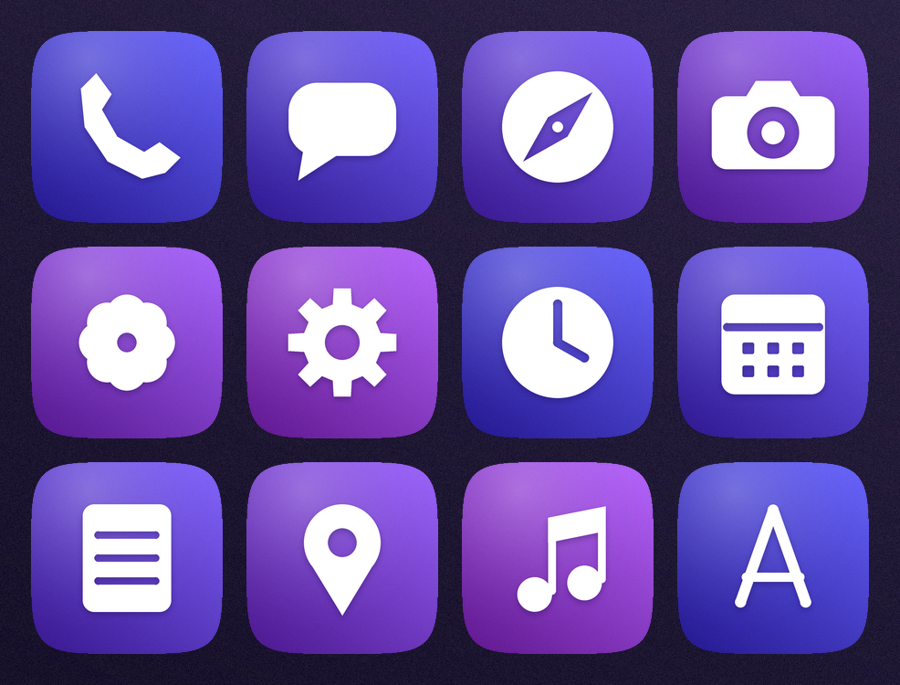

### Mono
Near-black with thin white line art and a single colour dot.

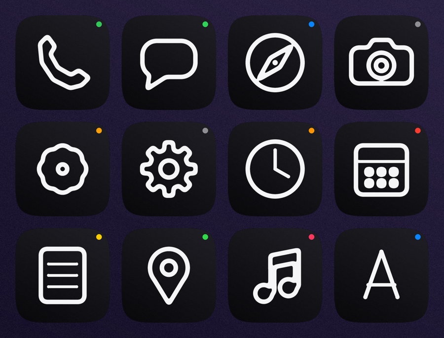

### Paper
Warm cream stock with ink glyphs on an offset colour print.

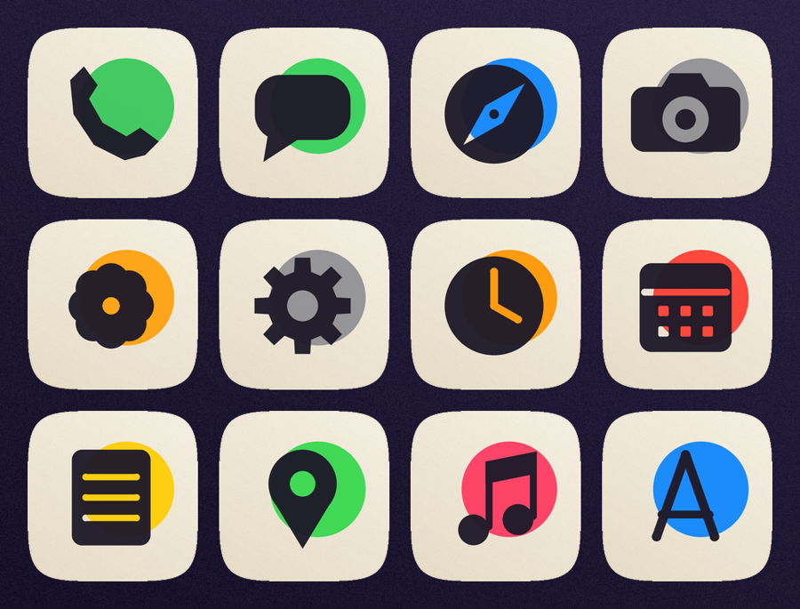

### Neon
Glowing tube-light outlines on midnight blue.

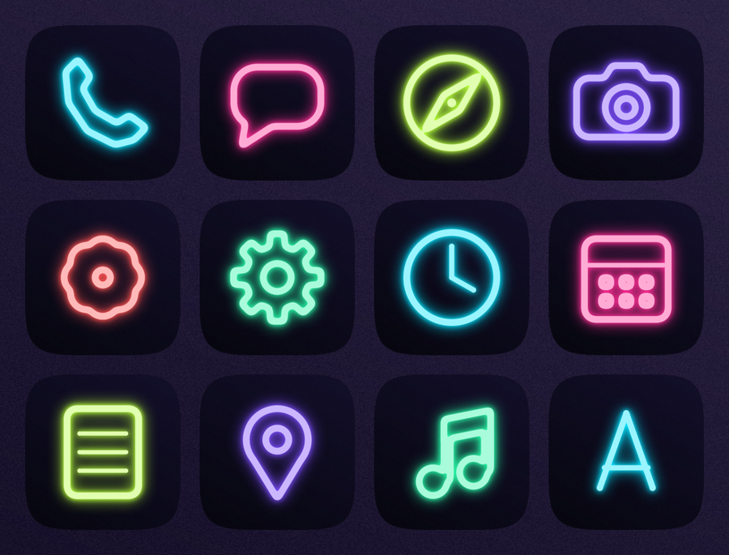

### Frost
Frosted pale glass with tinted, softly lit glyphs.

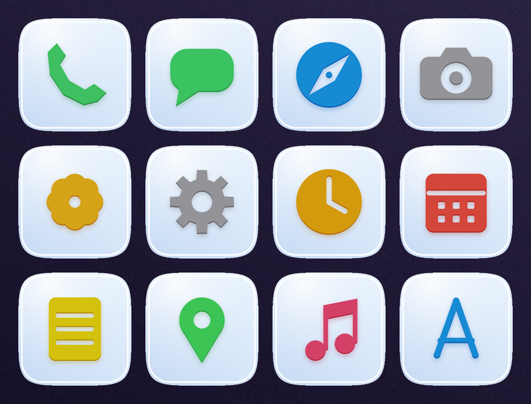

### Sunset
Warm orange-to-purple dusk with a low sun and white glyphs.

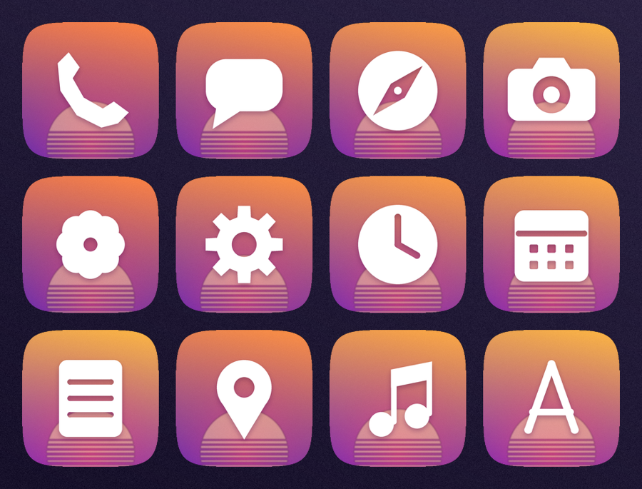

### Phosphor
Green terminal glow with scanlines on black.

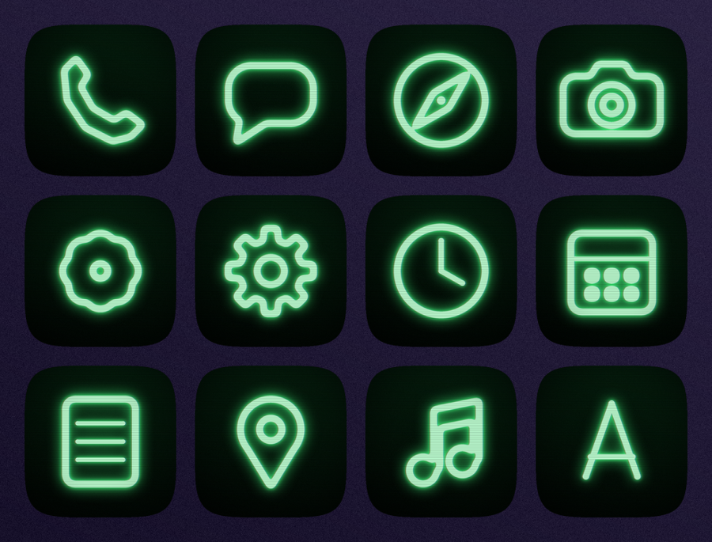

### Blueprint
White line drawings on blue graph paper.

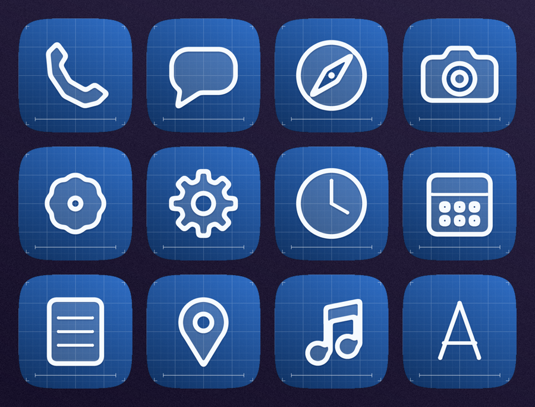

### Pixel
Chunky 8-bit glyphs on a dark pixel grid.

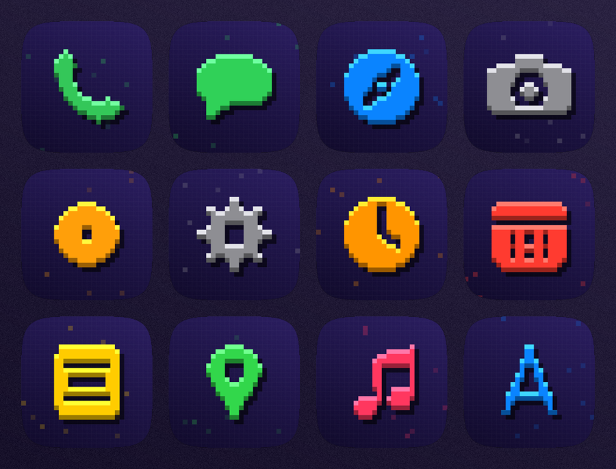

### Doodle
Flat colour, wobbly marker outlines and a little pair of eyes.

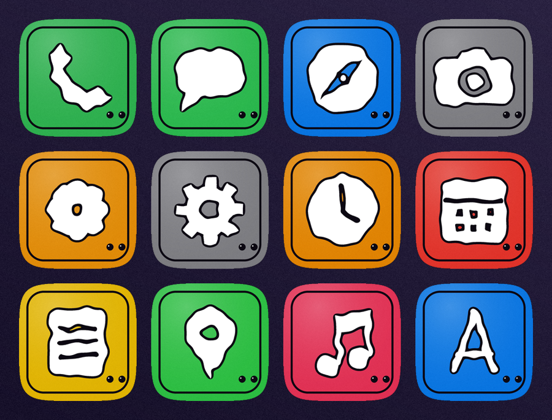

## Works with

Any jailbreak should work if it gives you iOS 12 on an arm64 device, a rootful filesystem, a tweak injector (Substrate, Substitute or libhooker) and PreferenceLoader.

| Jailbreak | iOS | Devices | Notes |
| --- | --- | --- | --- |
| **checkra1n** | iOS 12.0 to 14.8.1 | A7 to A11 chips: iPhone 5s up to iPhone X, plus iPads and iPods with the same chips | Semi-tethered: run it from a Mac or Linux PC again after every reboot. Rootful on iOS 12, so everything installs the normal way. The main target for this repo. |
| **Odysseyra1n** | iOS 12.0 to 14.8.1 | Same devices as checkra1n | Runs on top of checkra1n and also needs a computer after every reboot. It uses libhooker where older jailbreaks use Substrate; libhooker stands in for it. |
| **Amethyst** | iOS 12.0 to 13.7 | arm64 devices (listed for all devices on those versions) | Released June 2026. Semi-untethered: sideload the app and tap to re-jailbreak after a reboot. It loads tweaks, and a community write-up reports it working on an iPhone 6 running iOS 12.5.8. |
| **unc0ver** | iOS 12.0 to 12.4.8 (skips 12.3 to 12.3.2) | A7 to A11 chips, partial support on A12 | Does not cover iOS 12.5.x. If you are on 12.5.x, use one of the others. |
| **Chimera** | iOS 12.0 to 12.5.7 | A7 to A12 chips | Comes with Substitute and Sileo. iOS 12.5.x needs the community chimera_patch. |

**Not compatible:** Odyssey (iOS 13), Taurine (iOS 14), Dopamine, palera1n and XinaA15 (iOS 15 and up), and any jailbreak for iOS 13 or later. Amethyst and Odysseyra1n can reach those versions, but these packages are only built for iOS 12 and rootful systems.

Version ranges checked against public sources in October 2026. They can change, so confirm on each project's own page. These packages were not tested on every one.

## Requirements

- iOS 12.0 to 12.5.8, jailbroken, arm64 (iPhone 5s and later)
- A rootful jailbreak such as checkra1n, unc0ver or Chimera
- Substrate or Substitute, and PreferenceLoader (installed automatically)

## Troubleshooting

- **A package doesn't show up in Sileo.** Pull down on the Sources tab to refresh. If it still isn't there, remove the source and add it again. GitHub Pages can cache the package list for a few minutes after an update.
- **A tweak has no entry in Settings.** Make sure PreferenceLoader is installed, then respring.
- **Something looks wrong after installing a tweak.** Turn that tweak's switches off in Settings. If SpringBoard won't load, use safe mode from your jailbreak app.
- **A theme isn't applied.** Themes need Snowboard or Anemone. Respring after applying.

These tweaks are provided as-is and were written for fun. Back up before you try anything new.

## Source

The tweaks are plain Objective-C, built with clang against the iOS 12 SDK. Everything needed to rebuild the repo is in [`src/`](src):

- `src/tweaks/` the tweaks (`Tweak.m` hooks SpringBoard, `Prefs.m` is the Settings page)
- `src/common/` shared helpers
- `src/art.py`, `src/themes.py` the logo, icons and theme generators (Python, Pillow)
- `src/build.py`, `src/assemble.py` build the `.deb` files and this repo folder

## Layout

```
debs/         .deb packages
icons/        package icons shown in Sileo
depictions/   Sileo package pages (JSON)
assets/       logo, banner and theme previews
Release, Packages, Packages.bz2, Packages.gz   what the package managers read
index.html    the website
```
